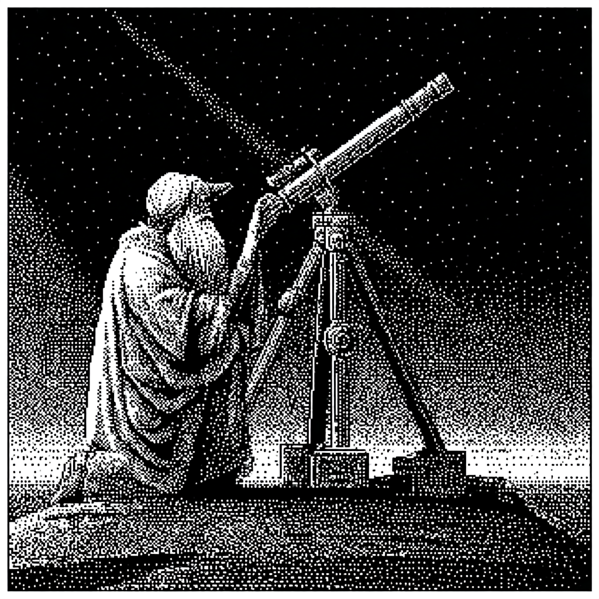
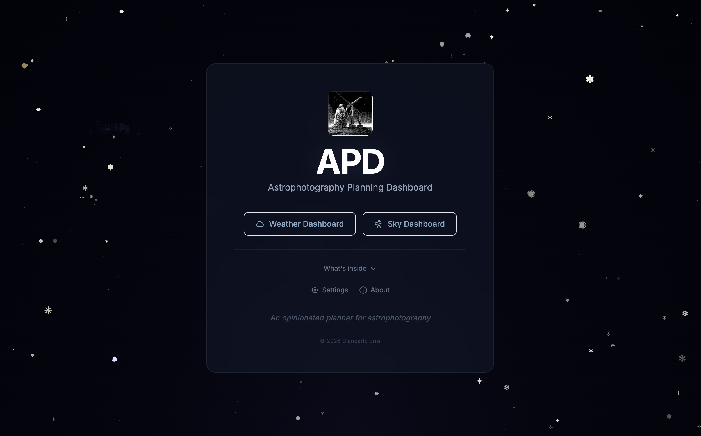
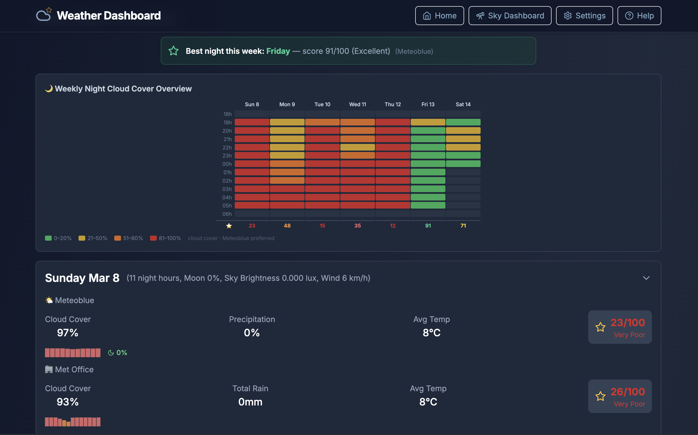
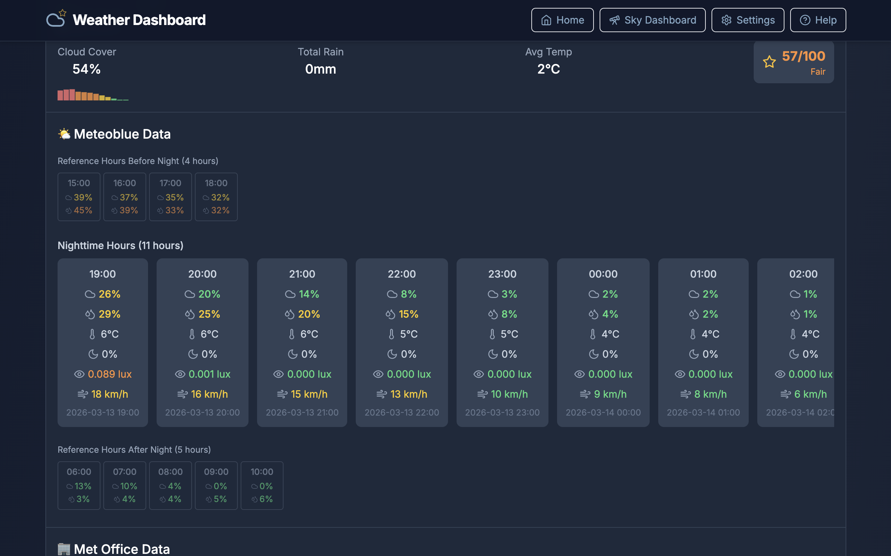
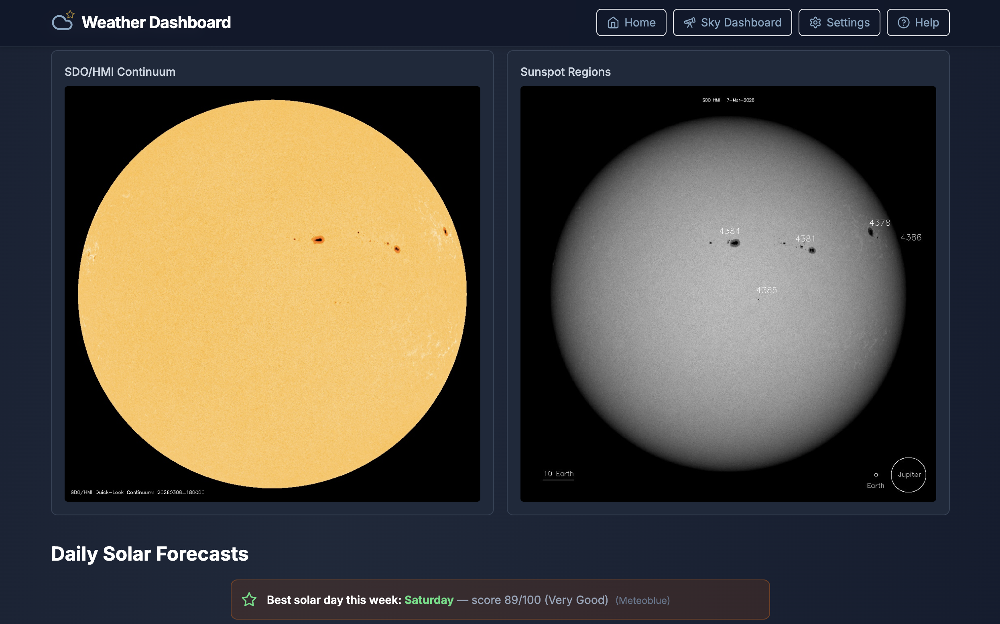
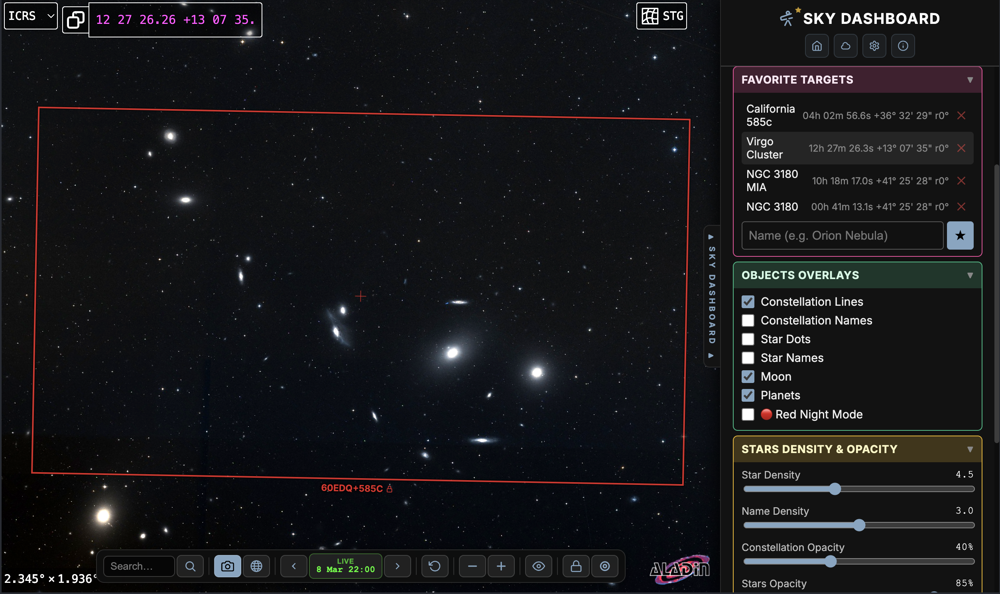
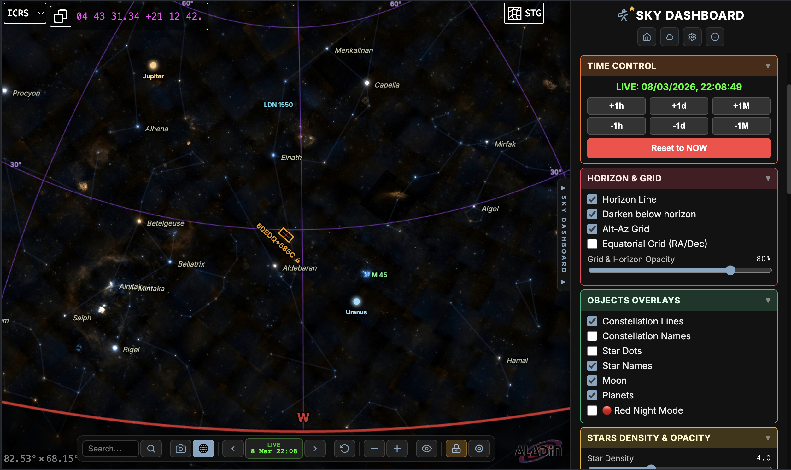

<p align="center">
  
</p>

# 🌟 APD — Astrophotography Planning Dashboard

[](https://github.com/giancarloerra/apd/actions/workflows/ci.yml)
[](LICENSE)
[](package.json)

After two decades of astrophotography, and using pretty much every weather and sky chart tool out there, I grew frustrated as the tools were either too complex or simplistic.

So I made APD, Astrophotography Planning Dashboard, a unified web application for astrophotography planning. Combines weather forecasts from Open-Meteo models, MET Norway, 7Timer, optional Meteoblue and optional MetService with an interactive visual sky chart (Aladin Lite + Telescopius) for framing and planning, and a complete weather API for scripts and AI integrations.

Two years ago I started building this for myself, and it evolved into my one-stop-shop for all my planning needs, from night & day (deep sky and solar) weather forecasts to a sky chart highly focused on visual framing and planning.

All packed into a universal web based app, easy to access from any device, with centralised data.

I've decided to open source it as I think it could be useful to other astrophotographers, and maybe build it into something even better. It will always be "An Opinionated Dashboard for Planning Astrophotography" — my personal vision of the perfect tool, but I'm excited to open it to contributions and suggestions from the community!

If you want to see what I actually point all this planning at, my astrophotography is at [astro.observer](https://astro.observer). I also built an [Interactive Solar System 3D Model](https://astro.observer/orrery/) that runs in the browser on real NASA/JPL orbital data, open source like this one ([source](https://github.com/giancarloerra/Astro.Observer-Orrery)).

---

> **🌟 Like what you see?** This app is all about chasing stars — so why not give it one?
> A [GitHub star](https://github.com/giancarloerra/apd/stargazers) helps others discover APD and keeps the motivation going. Cheers! ⭐

---

## Table of Contents

- [📸 Screenshots](#-screenshots)
- [🌐 Quick Installation / Deployment (on Render.com)](#-quick-deployment-on-rendercom)
- [💻 Quick Installation / Running locally on your computer](#-quick-installation--running-locally-on-your-computer)
- [✨ Features](#-features)
- [🌍 Self-hosting overview](#-self-hosting-overview)
- [🔑 Required services and API keys](#-required-services-and-api-keys)
- [🚀 Deployment Guide](#-deployment-guide)
- [⏰ Automated Weather Refresh](#-automated-weather-refresh)
- [🆘 Support / hosting help](#-support--hosting-help)
- [🏗️ Architecture](#️-architecture)
- [🔐 Authentication](#-authentication)
- [⚙️ Environment Variables](#️-environment-variables)
- [🚀 Local Development](#-local-development)
- [🌤️ Weather Data Sources](#️-weather-data-sources)
- [🔭 Shared Observer Location](#-shared-observer-location)
- [📊 API Endpoints](#-api-endpoints)
- [📁 File Structure](#-file-structure)
- [🤝 Contributing](#-contributing)
- [🔭 The rest of what I do](#-the-rest-of-what-i-do)
- [📝 License](#-license)

---

## 📸 Screenshots

<table>
  <tr>
    <td align="center"><br/><sub>Home / Landing Page</sub></td>
    <td align="center"><br/><sub>Weather Dashboard (weekly heatmap)</sub></td>
  </tr>
  <tr>
    <td align="center"><br/><sub>Weather Dashboard (hourly details)</sub></td>
    <td align="center"><br/><sub>Solar Forecast</sub></td>
  </tr>
  <tr>
   <td align="center"><br/><sub>Sky Dashboard</sub></td>
   <td align="center"><br/><sub>Sky Dashboard (camera FOV & mount type)</sub></td>
  </tr>
  <tr>
   <td align="center"><br/><sub>Sky Dashboard (favourites & objects options)</sub></td>
   <td align="center"><br/><sub>Sky Dashboard (Aladin sky DSS and Surveys options)</sub></td>
  </tr>
  <tr>
   <td align="center"><br/><sub>Sky Dashboard (Telescopius integration: best objects, searching & lists)</sub></td>
   <td align="center"><br/><sub>Sky Dashboard (EQ/AZ mounts and overlays view options)</sub></td>
  </tr>
  <tr>
   <td align="center"><br/><sub>Sky Dashboard (All the supported DSO catalogues)</sub></td>
   <td align="center"><br/><sub>Sky Dashboard (Natural visual colours survey)</sub></td>
  </tr>
</table>

---

## 🌐 Quick Installation / Deployment (on Render.com)

APD is an online self-hosted free app. Instead of signing up on a hosted service, you spin up your own private copy of the app — on a free or cheap cloud platform — and get your own URL to access it.

You can deploy it directly fto Render.com (see next section), or use other cloud platforms like Railway, Fly.io, etc. (see the [Deployment Guide](#-deployment-guide) section).

### Easiest and quickest installation: deploy directly from this repository to Render.com

Render.com lets you deploy straight from this public repository URL — just point it at the address below, set your environment variables, and you're done.

1. Create a free account at [render.com](https://render.com)
2. Click **New → Web Service**, choose **Connect a repository**, and when prompted paste or search for:
   `https://github.com/giancarloerra/apd`
3. Set the following:
   - **Build command**: `npm ci --include=dev && npm run build`
   - **Start command**: `npm start`
4. In the **Environment** tab, add these variables (enter each as a key-value pair, or click **Add from .env** to bulk-import from your local file):
   - `UPSTASH_REDIS_REST_URL` — from your Upstash dashboard (check [🔑 Required services and API keys](#-required-services-and-api-keys))
   - `UPSTASH_REDIS_REST_TOKEN` — from your Upstash dashboard (check [🔑 Required services and API keys](#-required-services-and-api-keys))
   - `METEOBLUE_API_KEY` — optional, from your Meteoblue account (check [🔑 Required services and API keys](#-required-services-and-api-keys))
   - `METSERVICE_API_KEY` — optional, for the MetService Point Forecast API
   - `MASTER_PASSWORD` — a password to protect your dashboard (recommended)
   - `TELESCOPIUS_API_KEY` — from your Telescopius account (optional) (check [🔑 Required services and API keys](#-required-services-and-api-keys))
   - `NODE_ENV=production`
5. Click **Create Web Service** — Render builds and deploys automatically.

> **⚠️ Security:** If the app is exposed to the internet, **always set `MASTER_PASSWORD`** to a strong, unique password. Without it, anyone who discovers your URL can view your weather data and sky chart, change your API keys, and modify your stored settings. This is the only access control the app has — treat it like the master key to your dashboard.

> **Updates:** Render can auto-deploy whenever this repository releases an update if you authorised the Render GitHub App to access it during setup. Otherwise a one-click manual redeploy is always available from the Render dashboard.

---

## 💻 Quick Installation / Running locally on your computer

You can run APD entirely on your own machine — no cloud hosting needed. This is great if you prefer to run everything local or you're not comfortable with deploying to a cloud platform.

You will still need an Upstash Redis account and an internet connection. The keyless weather sources work without Meteoblue or MetService; those optional keys add their forecasts. See [🔑 Required services and API keys](#-required-services-and-api-keys).

### What you need to install first

APD supports **Node.js 22.22.2 or later 22.x, 24.15.0 or later 24.x, or 26+**. Node 18 and 20 are no longer supported by the development toolchain. Existing settings and stored data do not need a migration.

<details>
<summary><strong>Windows</strong></summary>

1. Download the **Node.js 22 installer**, version 22.22.2 or later, from [nodejs.org](https://nodejs.org/en/download).
2. Run the installer — accept the defaults and click through.
3. When finished, open **Command Prompt** (press `Win + R`, type `cmd`, press Enter).
4. Verify the installation:
   ```
   node --version
   npm --version
   ```
   Both commands should print a version number (e.g. `v22.x.x` and `10.x.x`).

</details>

<details>
<summary><strong>macOS</strong></summary>

1. Download the **Node.js 22 installer**, version 22.22.2 or later, from [nodejs.org](https://nodejs.org/en/download).
2. Open the downloaded `.pkg` file and follow the prompts.
3. Open **Terminal** (press `Cmd + Space`, type `Terminal`, press Enter).
4. Verify the installation:
   ```
   node --version
   npm --version
   ```
   Both commands should print a version number.

</details>

<details>
<summary><strong>Linux (Ubuntu / Debian)</strong></summary>

1. Open a terminal and run:
   ```bash
   sudo apt update
   sudo apt install -y nodejs npm
   ```
   If the installed version is below 22.22.2, use the [NodeSource](https://github.com/nodesource/distributions#installation-instructions) setup instead:
   ```bash
   curl -fsSL https://deb.nodesource.com/setup_22.x | sudo -E bash -
   sudo apt install -y nodejs
   ```
2. Verify the installation:
   ```
   node --version
   npm --version
   ```

</details>

### Download and set up APD

1. **Download the app**: go to [github.com/giancarloerra/apd](https://github.com/giancarloerra/apd), click the green **Code** button, then **Download ZIP**. Extract the ZIP to a folder of your choice (e.g. your Desktop or Documents folder).

2. **Open a terminal in that folder**:
   - **Windows**: open the extracted `apd-main` folder in File Explorer, click in the address bar, type `cmd`, and press Enter.
   - **macOS**: right-click the `apd-main` folder and choose **New Terminal at Folder** (or open Terminal and type `cd ` followed by dragging the folder into the Terminal window, then press Enter).
   - **Linux**: right-click the `apd-main` folder and choose **Open in Terminal** (or `cd` to it manually).

3. **Install dependencies** — run this command in the terminal:
   ```
   npm ci
   ```
   This downloads all the libraries APD needs. It may take a minute.

4. **Create your configuration file**: in the `apd-main` folder, find the file called `.env.example`, make a copy of it, and rename the copy to `.env` (just `.env`, nothing else). You can do this from the terminal:
   - **Windows**: `copy .env.example .env`
   - **macOS / Linux**: `cp .env.example .env`

5. **Edit the `.env` file** with any text editor (Notepad, TextEdit, etc.) and fill in your values:
   - `UPSTASH_REDIS_REST_URL` — the REST URL from your Upstash dashboard
   - `UPSTASH_REDIS_REST_TOKEN` — the REST token from your Upstash dashboard
   - `METEOBLUE_API_KEY` — your Meteoblue API key, optional
   - `METSERVICE_API_KEY` — your MetService Point Forecast API key, optional
   - `MASTER_PASSWORD` — optional when running locally; leave blank if you're the only user
   - `TELESCOPIUS_API_KEY` — optional; only needed for the Sky Dashboard's Discover panel

   Save the file.

### Build and run

Still in the same terminal, run:

```
npm run build
npm start
```

The first command builds the frontend (takes a few seconds). The second starts the server. You should see output like:

```
Server running on port 3001
```

Open your browser and go to **http://localhost:3001** — APD is now running on your machine.

### Stopping and restarting

- To **stop** the server, press `Ctrl + C` in the terminal.
- To **start it again** later, open a terminal in the same folder and run `npm start` (you don't need to rebuild unless the app has been updated).
- To **update** to a newer version, use a supported Node version, download the latest ZIP from GitHub, extract it over the same folder, keep `.env`, run `npm ci`, then `npm run build` and `npm start`.

---

## ✨ Features

### 🌙 Weather Dashboard

- **Multi-source forecasts** — an all-provider average above equally styled provider rows, with individual source choices for night/day heatmaps and hourly detail; existing graphics and provider score formulas are retained
- **Night-only filtering** — displays only astronomically relevant hours (4 h before night → 10 AM after)
- **Astrophotography score** — 0–100 composite score per night per source, weighted from cloud cover (80%) and precipitation (20%); labels: Excellent / Very Good / Good / Fair / Poor / Very Poor
- **7-day expandable forecast** — per-day rows with hourly cards showing cloud cover, temperature, precipitation, wind, humidity
- **Cloud cover sparkline** — at-a-glance bar chart of the night's cloud variation per row
- **Weekly cloud cover heatmap** — colour-coded grid of every night hour across the forecast week, with per-day score row
- **Best night banner** — highlights the highest-scoring night at a glance
- **Moonlight** — per-night average luminance (lux) and display percentage, colour-coded by impact
- **Sky brightness & wind** — shown inline per night row
- **Solar astrophotography section** — daytime cloud forecasts for H-alpha / solar imaging, with live SDO/HMI solar imagery and sunspot region images
- **Weekly solar heatmap** — same heatmap layout applied to daytime hours
- **Auto / manual weather refresh** — data downloads automatically on demand if stale; optional cron job pre-fetches twice daily; manual refresh also available from the header
- **Download status indicator** — shows last download time or in-progress state
- **LLM-friendly summary endpoint** — returns structured JSON optimised for AI/LLM consumption; always public (no auth), perfect for daily automation workflows — e.g. a scheduled job that reads the forecast and emails you if tonight or tomorrow night look promising

### 🔭 Sky Dashboard

- **Interactive sky map** — Aladin Lite v3 with 17+ selectable surveys across **Optical** (DSS2, PanSTARRS, SDSS9, Mellinger, DECaPS, DESI Legacy), **H-Alpha** (VTSS, Fink, SHASSA), **Infrared** (2MASS, AllWISE, AKARI), **UV / X-Ray / Gamma** (GALEX UV, XMM, Fermi, ROSAT), and **Radio** (NVSS, GLEAM)
- **Two modes** — *Framing* (camera overlay tools) and *Sky Chart* (pure sky exploration)
- **Camera FOV overlay** — define sensor FOVs by width × height (degrees), saved to Redis; lock to any target
- **Mosaic planner** — overlay a configurable N × M tile grid with adjustable overlap percentage
- **Camera angle offset** — rotation slider for precise framing alignment
- **Equatorial & Alt-Az mount support** — FOV box aligned to RA/Dec or horizon depending on mount type
- **Favorite targets** — save and recall objects, synced to Redis; import directly from Telescopius lists
- **Target search** — jump to any object by name (e.g. M 42, IC 434)
- **Time travel** — step the sky forward/backward by hours, days, or months; reset to now
- **Celestial overlays** — constellation lines, names, star dots, star names, Moon (with phase info), planets
- **Red night mode** — full-screen red overlay for preserving dark adaptation
- **Horizon line** — with optional ground darkening and configurable opacity
- **Alt-Az and equatorial grids** — toggleable with shared opacity slider
- **Deep Sky Objects** — Messier, NGC, IC, LDN/B catalogs; filterable by type (galaxies, nebulae, dark nebulae, globular + open clusters, planetary nebulae); magnitude limit slider
- **Star density & opacity** — magnitude-limit and name-density sliders, plus separate constellation and star opacity controls
- **Discover panel (Telescopius)** — tonight's DSO highlights (filterable by type), target search with type/sort filters, personal Telescopius observing lists, solar system rise/set/transit times
- **Live RA / Dec display** — equatorial coordinates at map centre, updated in real time

---

## 🌍 Self-hosting overview

APD is a **self-hosted** app (you can run it locally or privately host it for yourself for remote access). Instead of signing up on a hosted service, you spin up your own private copy of the app — on a free or cheap cloud platform — and get your own URL to access it.

You don't need to own a server or know how to manage infrastructure. Platforms like [Render](https://render.com) make it as simple as linking to a Github repository (another simple and free service), setting a few variables, set the password to protect it (so only you can access it), and clicking Deploy. Your data stays private, you control updates, and there are no subscription fees for the app itself.

### What you'll need

| Service | What it's for | Cost |
|---------|---------------|------|
| **Render** (or similar) | Runs the APD server in the cloud | Free tier available |
| **Upstash Redis** | Stores your settings: location, camera profiles, favourites, API keys | Free tier available |
| **Open-Meteo, MET Norway, 7Timer** | Keyless weather and native astronomy forecasts | Subject to provider terms and usage limits |
| **Meteoblue API** (Optional) | Additional weather, Moon and sky-brightness data | Eligible trial or paid credits |
| **MetService API** (Optional) | Additional worldwide Point Forecast data | Account/model access and production-use terms apply |
| **Telescopius API** (Optional) | Sky Dashboard Discover panel — DSO highlights, target search, observing lists | Patron-only |
| **cron-job.org** (Optional) | Triggers weather downloads twice daily (optional but recommended) | Free |
| **GitHub** (Optional) | Hosts your copy of the code; cloud platforms deploy from it | Free |

The next section walks through each service and how to get started.

---

## 🔑 Required services and API keys

Before you deploy, create accounts at the services below and gather the credentials you'll need.

### Upstash Redis — free, required

APD stores your observer location, camera FOVs, favourite targets, and runtime-configured API keys in a Redis database. Upstash provides a serverless Redis with a permanently free tier — no credit card required.

1. Sign up at [upstash.com](https://upstash.com)
2. Click **Create Database** → choose **Redis** → pick any region close to you
3. On the database detail page, copy:
   - **REST URL** → this becomes `UPSTASH_REDIS_REST_URL`
   - **REST Token** → this becomes `UPSTASH_REDIS_REST_TOKEN`

Free tier: 256 MB storage, 500,000 commands/month — well within personal use.

### Meteoblue API — optional

Meteoblue adds weather, Moon and sky-brightness data. Its API uses package-dependent credits. Check the current trial or paid plan for your account. APD requests `basic-1h_clouds-1h_sunmoon_moonlight-1h` once per weather refresh.

1. Create a free account at [meteoblue.com](https://www.meteoblue.com)
2. Click your account icon (top right) → **Account Overview**
3. Click the **Weather API** box and confirm non-commercial use to activate the free year
4. Your API key appears in the API section of your account

Without a key, Meteoblue is omitted from forecast cards and selectors; the other providers continue independently.

### MetService Point Forecast API — optional

Obtain a key for the [Point Forecast API](https://data.metservice.com/product/point-forecast-api), then set `METSERVICE_API_KEY` or save it in Settings → API Keys. The environment value takes priority over a stored key. Requests use the server-side `x-api-key` header; the browser receives key-status metadata only.

The API covers the world, but accessible models depend on the account. Do not assume a free Starter account permits production use; check the provider's current terms. APD requests cloud cover, temperature, humidity, wind and precipitation rate. Rain rate is labelled `mm/h`, not presented as a fabricated accumulated rainfall total. The app works without this optional key.

### Telescopius API — patron-only, optional

Used for the Sky Dashboard's **Discover panel** — tonight's DSO highlights, object search, and personal observing lists. All other sky dashboard features (sky map, FOV overlay, mosaic planner, star charts, etc.) work without it.

The Telescopius API is available to patrons and sponsors of the project. If you already support [Telescopius](https://telescopius.com):

1. Log in at [telescopius.com](https://telescopius.com) → account **Settings** → **API Keys**
2. Generate a new key
3. Enter the key in APD's Settings page at any time (saved to Redis — no redeploy needed)

If you don't have a Telescopius key, the sky dashboard still works fully — only the Discover panel stays hidden.

### cron-job.org — optional, free

APD fetches fresh weather data automatically when you open the dashboard, but for proactive twice-daily updates (so the forecast is always ready when you need it), point a free HTTP cron job at your deployed URL. See [Automated Weather Refresh](#-automated-weather-refresh) for the full setup.

---

## 🚀 Deployment Guide

### Choosing a hosting platform

APD is a Node.js Express app that serves both the API and the built React frontend from a single process. Any platform that can run a persistent Node.js process and set environment variables will work.

| Platform | Notes | Cost |
|----------|-------|------|
| **Render** (recommended) | Zero-config, auto-deploy on push | Free tier (spins down after 15 min idle); ~$7/mo for always-on |
| **Railway** | Slightly faster cold starts | $5/mo Hobby plan (includes $5 usage credits) |
| **Fly.io** | More control, Docker-based, global regions | Free tier (limited); pay-as-you-go |
| **DigitalOcean App Platform** | Solid, predictable pricing | From ~$5/mo |
| **Self-hosted VPS** | Full control, cheapest at scale | Depends on provider |

### Deploy to Render (step by step)

1. Create a new **Web Service** on [render.com](https://render.com).
   - **No GitHub account / no fork:** choose **Connect a repository** and paste `https://github.com/giancarloerra/apd` directly.
   - **Fork first (for developers):** fork this repo to your GitHub account (see [Installing / using APD](#-installing--using-apd)) and connect your fork.
2. Connect your chosen repository.
3. Set the following:
   - **Environment**: `Node`
   - **Build command**: `npm ci --include=dev && npm run build`
   - **Start command**: `npm start`
   - **Node version**: `22.22.2` or a later Node 22 release
4. Add environment variables under the **Environment** tab:
   - Add each variable as a **key-value pair**, **or** click **"Add from .env"** to paste / import your local `.env` file in bulk (this is a Render dashboard feature, not a file upload — the variables are stored securely by Render).
   - Do **not** use Render's *Secret Files* for this — secret files are mounted at `/etc/secrets/` and are not automatically loaded as environment variables.
5. Click **Create Web Service** — Render builds and deploys automatically.

> **⚠️ Security:** If your instance is accessible from the internet (e.g. deployed on Render, Railway, Fly.io, or any public host), you **must set `MASTER_PASSWORD`** to a strong, unique password. Without it every route is open — anyone who discovers your URL can access your dashboard, change API keys, and modify stored settings. The password is the only access control the app provides. Use a randomly generated password of at least 16 characters and store it safely. Leaving the password unset is only appropriate when the app runs on a private/local network you fully trust.

On every push to `main`, Render will redeploy automatically.

### Deploy to Railway

1. Create a new project on [railway.app](https://railway.app) and choose **Deploy from GitHub repo**.
2. Select your fork, or connect the upstream repo (`giancarloerra/apd`) directly if you don't want to fork. Let Railway detect the Node.js service.
3. Set the same environment variables in the Railway **Variables** panel.
4. Railway sets `PORT` automatically — no action needed.

### Environment variables reference

| Variable | Required | Description |
|----------|----------|-------------|
| `UPSTASH_REDIS_REST_URL` | **Yes** | Upstash Redis REST URL (free tier at [upstash.com](https://upstash.com)) |
| `UPSTASH_REDIS_REST_TOKEN` | **Yes** | Upstash Redis REST token |
| `MASTER_PASSWORD` | No | Master password — if unset, all routes are open (fine for private/personal use behind a trusted network) |
| `SESSION_SECRET` | No | Secret for signing session tokens — auto-generated if unset, but set it explicitly in production so sessions survive restarts |
| `METEOBLUE_API_KEY` | No* | Optional Meteoblue forecast; keyless providers continue without it |
| `METSERVICE_API_KEY` | No* | Optional MetService Point Forecast key; can also be saved in Settings |
| `TELESCOPIUS_API_KEY` | No* | Telescopius API key — without it, sky chart DSO features are disabled; can also be set at runtime via Settings UI |
| `OBSERVER_LAT` | No | Default observer latitude (e.g. `52.6278`) |
| `OBSERVER_LON` | No | Default observer longitude (e.g. `-1.2983`) |
| `OBSERVER_ALT` | No | Default observer altitude in metres (e.g. `25`) |
| `PORT` | No | Server port — platforms set this automatically; default `3001` |
| `NODE_ENV` | No | Set to `production` to enable HTTPS redirect and secure cookies |
| `CORS_ORIGIN` | No | Comma-separated list of allowed origins in production (e.g. `https://apd.example.com`). Defaults to open in development, closed in production if not set. |

\* API keys can be set via environment variable **or** through the Settings UI (where they are stored in Redis). The environment variable takes priority.

### Setting up automated weather downloads

When you open the dashboard and the weather data is stale (older than 2:30 PM the previous day), APD will download fresh data automatically within that request — but you'll wait a few seconds while it fetches. A cron job pre-fetches the data on a fixed schedule so it's always ready the moment you open the app.

**Step 1 — Generate a trigger key**

Go to **Settings → Automated Weather Refresh** and click **Generate Key**. A unique URL will appear — copy it immediately (the key is only shown once). The URL looks like:

```
https://your-app.example.com/api/weather/refresh/trigger?key=<random-64-char-hex>
```

You can rotate or revoke the key at any time from the same Settings card.

**Step 2 — Set up a cron service**

**Option A — cron-job.org (free, recommended)**

1. Sign up at [cron-job.org](https://cron-job.org).
2. Create two jobs using the trigger URL you copied above.
3. Suggested schedule: `30 9 * * *` (09:30) and `35 13 * * *` (13:35).

**Option B — GitHub Actions scheduled workflow**

Add a workflow that calls the trigger URL on a schedule:

```yaml
- run: curl -sf "${{ secrets.APD_TRIGGER_URL }}"
```

**Alternative — environment variable**

If you prefer to manage the token outside the UI, set `CRON_TRIGGER_TOKEN` in your `.env` or hosting dashboard. The trigger URL is then: `https://<your-app-url>/api/weather/refresh/trigger?key=<your-token-value>`.

---

## ⏰ Automated Weather Refresh

### Scheduled Downloads

A cron service calls the trigger endpoint on a schedule to pre-fetch fresh data before you open the dashboard. Without it the app still works — it downloads on demand when you visit — but you wait a few seconds. With it, data is always ready instantly.

- **Service**: any free HTTP cron service (e.g. [cron-job.org](https://cron-job.org), GitHub Actions scheduled workflows, Render cron jobs)
- **Endpoint**: `<your-app-url>/api/weather/refresh/trigger?key=<your-key>` (shown in Settings after you generate the key)
- **Key management**: generate, rotate, or revoke from **Settings → Automated Weather Refresh** (or set `CRON_TRIGGER_TOKEN` env var)
- **Rate limit**: 3 requests/minute (separate from the manual refresh limit of 5/min)
- **Recommended schedule**: once ~10:30 and once ~14:35 local time
- **Timezone handling**: the staleness check uses your server's local time — no extra config needed

### Email Notifications

Use a script, scheduler or automation service to fetch the complete forecast and send a notification after a scheduled refresh:

- **Trigger**: schedule a second HTTP call ~5 minutes after the cron refresh
- **Content**: fetch `https://your-apd.example.com/api/weather/summary?v=2`. Check that the HTTP request succeeds and `schemaVersion` is `2` before processing it. Report HTTP failures through your own workflow instead of treating them as a forecast.
- **Classification**: use `nightSessions[].average.summary.score.value` and the accompanying contributor/coverage metadata, rather than hardcoding two provider names.

### General AI prompt example

The [copyable prompt](docs/ai-forecast-prompt.md) works with any AI tool that accepts text and JSON. Replace `<CURRENT_TIMESTAMP_ISO_8601>` with the current timestamp, `https://your-apd.example.com/` with your dashboard URL, and `<APD_FORECAST_JSON>` with the successful v2 response. No platform-specific tokens are required.

The example uses APD's **Good threshold of 60**, gives today's night priority over tomorrow, and requires complete aggregate cloud/score coverage. It returns only:

```json
{"subject":"GOOD NIGHT TODAY","body":"https://your-apd.example.com/"}
```

The other subjects are `GOOD NIGHT TOMORROW` and `Astro Forecast`. The latter is used when neither today nor tomorrow qualifies, including when only later nights look good. Dates use the response's observer timezone, not the automation server's timezone. Adjust the stated threshold if your observing requirements differ.

---

## 🆘 Support / hosting help

APD requires a few third-party accounts and some technical setup. If you need help, you can reach out at **giancarloerra@gmail.com** (I won't be able to help deploying this for free, but I can answer questions and point you in the right direction, or provide guidance for paid assistance).

- **GitHub Issues** — [open a bug report or question](https://github.com/giancarloerra/apd/issues) for anything related to the app itself.
- **GitHub Discussions** — for general help, deployment questions, and ideas.

---

## 🏗️ Architecture

### Frontend

- **Weather Dashboard**: React 18 + TypeScript + Tailwind CSS (Vite build)
- **Sky Dashboard**: Self-contained HTML page with Aladin Lite v3.6.5 sky viewer, jQuery 3.7.1 (Aladin dependency)
- **Icons**: Lucide React
- **Celestial data**: Star, constellation, and DSO data from [d3-celestial](https://github.com/ofrohn/d3-celestial) plus additional catalogs (SH2, LBN, vdB, HCG, Abell PNe) from [VizieR/CDS](https://vizier.cds.unistra.fr/) (bundled locally in `public/data/celestial/`)
- **Astronomy calculations**: Simplified VSOP87/Meeus for planet positions, moon position and phase — approximate, optimised for visual display rather than astrometric precision
- **Sky Dashboard persistence**: UI settings (panel state, sliders, toggles) stored in `localStorage` (`astro-sky-dashboard-v1`); FOVs and favorites stored in Redis via the API

### Backend

- **Runtime**: Node.js with ES modules
- **Framework**: Express.js
- **Persistent Storage**: Upstash Redis (weather data, FOVs, favorites, API keys, observer location)
- **Auth**: HMAC-SHA256 session tokens in httpOnly cookies

### Key Services

| Service | Purpose |
|---------|---------|
| **Upstash Redis** | Stores weather data, FOVs, favorites, API keys, observer location — shared across deploys |
| **Meteoblue API** | Optional weather, probability, wind, humidity, Moon and sky-brightness data |
| **Open-Meteo** | Met Office Global/UKV, ECMWF, GFS and ICON Global |
| **MET Norway / 7Timer** | Worldwide forecast and native three-hour astronomy ranges |
| **MetService API** | Optional worldwide Point Forecast data |
| **Telescopius API** | DSO highlights, search, solar system data for the sky dashboard |

### Data Flow

1. Client requests weather data from the Express API
2. Backend checks if cached data is fresh (< 24 hours old, after 2:30 PM yesterday)
3. If stale, refreshes configured weather sources independently using the shared observer location
4. Each provider's data or explicit failure status is cached independently in Redis
5. The server normalizes timestamps and units and builds the complete v2 result used by both the dashboard and API; the original summary response remains compatible
6. All users share the same cached data

---

## 🔐 Authentication

The app uses a single **master password** for access control.

- When `MASTER_PASSWORD` is set in `.env`, all routes require authentication (except `/api/health`, `/api/weather/summary`, and `/api/weather/refresh/trigger`)
- When `MASTER_PASSWORD` is **not set** (or empty), auth is completely disabled — all routes are open
- Sessions use HMAC-SHA256 signed tokens stored in httpOnly cookies (30-day expiry)
- The cron trigger endpoint uses a separate token-based auth (not session cookies) — see [Automated Weather Refresh](#-automated-weather-refresh)
- Login page served at `/login`

With password protection enabled, browser login/logout and protected write requests must come from the same origin or an origin listed in `CORS_ORIGIN`. Local development also permits the standard localhost/loopback addresses used by Vite. Untrusted or opaque browser origins receive HTTP 403. Server-side clients without an `Origin` header retain their existing authentication, and the public cron trigger keeps its token-based contract.

### Public Endpoints (always accessible, no auth required)

| Endpoint | Purpose |
|----------|---------|
| `GET /api/health` | Health check — also confirms Redis connectivity |
| `GET /api/weather/summary` | LLM-friendly weather forecast JSON (for AI integrations) |
| `GET/POST /api/weather/refresh/trigger?key=…` | Cron trigger — token-authenticated weather refresh (see Settings) |
| `GET /api/auth/check` | Check authentication status |
| `POST /api/auth/login` | Login with master password |
| `POST /api/auth/logout` | Clear session |
| `GET /login` | Login page |

### Protected Endpoints (require auth when `MASTER_PASSWORD` is set)

All other `/api/*` routes, the weather dashboard (`/weather`), sky dashboard (`/skychart.html`), settings page (`/settings`), about page (`/about`), and all other non-root app paths.

### Disabling Auth

To run without authentication (e.g., local development or future Electron app), simply leave `MASTER_PASSWORD` unset or empty in `.env`. The auth system is completely bypassed — no login page, no redirects, no cookie checks.

---

## ⚙️ Environment Variables

All configuration is via a `.env` file (see `.env.example`). The server loads it automatically when present; on cloud platforms, set env vars in the hosting dashboard instead.

Copy `.env.example` to `.env` and fill in your values:

```bash
cp .env.example .env
```

| Variable | Required | Description |
|----------|----------|-------------|
| `UPSTASH_REDIS_REST_URL` | **Yes** | Upstash Redis REST URL — used for FOVs, favorites, API keys, location |
| `UPSTASH_REDIS_REST_TOKEN` | **Yes** | Upstash Redis REST token |
| `MASTER_PASSWORD` | No | Master password — if unset, auth is disabled |
| `SESSION_SECRET` | No | Secret for signing session tokens — auto-generated if unset |
| `CRON_TRIGGER_TOKEN` | No | Cron trigger token — if set, the trigger endpoint accepts this value; otherwise manage via Settings UI → Redis |
| `METEOBLUE_API_KEY` | No* | Optional Meteoblue key; keyless sources continue without it |
| `METSERVICE_API_KEY` | No* | Optional MetService Point Forecast key; environment value takes priority over Settings |
| `TELESCOPIUS_API_KEY` | No* | Telescopius API key — without it, sky chart DSO features are disabled; can also be set via UI → Redis |
| `OBSERVER_LAT` | No | Default observer latitude (default: 52.6278) |
| `OBSERVER_LON` | No | Default observer longitude (default: -1.2983) |
| `OBSERVER_ALT` | No | Default observer altitude in metres (default: 25) |
| `PORT` | No | Server port (default: 3001) |
| `NODE_ENV` | No | Set to `production` for HTTPS redirect and secure cookies |
| `CORS_ORIGIN` | No | Comma-separated allowed origins in production (e.g. `https://apd.example.com`) |

\* API keys can be provided via `.env` or stored in Redis through the UI. The `.env` value takes priority.

---

## 🚀 Local Development

### Prerequisites

- Node.js 22.22.2+ (Node 22 recommended; see `package.json` for supported LTS versions)
- npm
- Upstash Redis account (free tier works)

### Setup

```bash
git clone <repository-url>
cd apd
npm ci
cp .env.example .env
# Edit .env with your credentials
```

### Run

```bash
npm run dev
```

This starts both:
- **Frontend** dev server on `http://localhost:5173` (Vite, with HMR)
- **Backend** server on `http://localhost:3001` (nodemon, auto-restarts on changes)

Vite proxies `/api` requests to `localhost:3001` automatically.

### Scripts

| Script | Description |
|--------|-------------|
| `npm run dev` | Start frontend + backend in development |
| `npm run client:dev` | Start only the Vite frontend dev server |
| `npm run server:dev` | Start only the backend with nodemon |
| `npm run build` | Build frontend for production (outputs to `dist/`) |
| `npm start` | Start production server |
| `npm run lint` | Run ESLint |
| `npm run typecheck` | TypeScript type-check (no emit) |
| `npm test` | Run unit tests with Vitest |
| `npm run test:coverage` | Run tests with coverage report |
| `npm run release` | Bump version, update CHANGELOG, create GitHub release |

### Testing & CI

Unit tests run with [Vitest](https://vitest.dev/) and cover both server utilities and frontend logic:

- `src/utils/weatherUtils.test.ts` — Meteoblue data processing, scoring, and night detection
- `server/utils/weatherProcessor.test.js` — legacy summary compatibility
- `server/services/forecastProviders.test.js` — provider schemas, units, native ranges, errors and cache-header handling
- `server/utils/forecastProcessor.test.js` — per-hour averaging, coverage, rain intervals, scores and observer timezones
- `server/services/weatherService.test.js` — independent refresh, persistence failures, configuration, repeated/concurrent reads and recovery
- `server/utils/forecastPresentation.test.js` — preserved provider values, card styling and exact heatmap mapping
- `server/routes.test.js` — public summary compatibility, protected key controls, persistence, environment precedence and production authentication through the real HTTP server
- `src/services/weatherService.test.ts` — complete-response consumption, failed-refresh status and actionable HTTP errors
- `server/utils/skychartSecurity.test.js` — stored names, Discover attributes and upstream time values remain text

```bash
npm test              # run tests
npm run test:coverage # run with coverage report
```

The CI workflow (`.github/workflows/ci.yml`) runs on every push and pull request to `main`. It lints, type-checks, tests and builds against **Node.js 22**. The release workflow uses the same Node major version.

### Releases

Releases are automated via [`release-it`](https://github.com/release-it/release-it). A GitHub Actions workflow (`.github/workflows/release.yml`) is triggered manually from the Actions tab — choose `patch`, `minor`, or `major`. It bumps `package.json`, updates `CHANGELOG.md`, tags the commit, and publishes a GitHub Release.

---

## 🤝 Contributing

Contributions are welcome. See [CONTRIBUTING.md](CONTRIBUTING.md) for development setup, commit conventions, and pull request guidelines.

---

## 🌤️ Weather Data Sources

### Sources and coverage

| Source | Coverage | Configuration |
| --- | --- | --- |
| Meteoblue | Worldwide | Optional API key; existing package unchanged |
| Met Office Global 10 km | Worldwide | Existing keyless Open-Meteo model |
| Met Office UKV 2 km | UK and Ireland model domain | Keyless; outside-domain locations are not provider outages |
| ECMWF IFS, GFS, ICON Global | Worldwide | Keyless Open-Meteo models |
| MET Norway | Worldwide, with finer regional models | No key; server sends identifying User-Agent and honours cache headers |
| 7Timer ASTRO | Worldwide; native three-hour samples, normally 72 hours | No key; cloud/seeing/transparency remain categorical ranges |
| MetService | Worldwide, with account-dependent model access | Optional API key; production-use terms apply |

Coverage references: [Open-Meteo model documentation](https://open-meteo.com/en/docs), [UKV coverage](https://open-meteo.com/en/docs/ukmo-api), [MET Norway](https://api.met.no/doc/locationforecast/datamodel), [7Timer](https://www.7timer.info/doc.php?lang=en), [MetService](https://developer.metservice.com/docs/api-catalog/point-forecast-api/).

The selected Open-Meteo models are `ukmo_global_deterministic_10km`, `ukmo_uk_deterministic_2km`, `ecmwf_ifs`, `gfs_global` and `icon_global`. Actual returned horizons and missing fields are reported, not replaced with another model's data. Hourly API output does not imply native hourly model resolution.

Open-Meteo's detected observer timezone is retained for display. When a new model's hourly clock falls between UTC hours, APD retrieves that model in GMT as well, retaining the original forecast span, so averages compare actual matching instants. This extra keyless request is needed only for fractional-hour offsets. Meteoblue keeps its existing single request. Cached records using the former clock are refreshed automatically.

### Integration

- **Time Structure**: explicit UTC instants and observer-local dates. Existing provider day/night flags and the early-morning night-date assignment are retained; the API reports expected timestamps and coverage
- **Display**: the all-provider average first, then provider rows in the existing night/day cards. Both heatmaps and hourly views default to the average and offer individual sources
- **Reference Hours**: Numeric forecasts show supplied reference samples from 4 hours before night through 10am after night
- **Statistics**: Sources with numeric cloud data calculate independent astrophotography scores. 7Timer's categorical cloud, seeing and transparency values are not scored
- **Scoring difference**: Meteoblue score uses cloud cover (80%) + precipitation (20%). Met Office score uses cloud cover only (Met Office reports precipitation in mm rather than %, so the precipitation penalty is not applied). Both are scaled 0–100.
- **Average**: arithmetic mean of actual comparable values per timestamp, then session summaries from those hourly aggregates. The average score is the mean of available numeric provider scores per timestamp, then across session timestamps. 7Timer's categorical cloud, seeing and transparency values are excluded from numeric cloud averages and scores. The score is not a confidence percentage
- **Missing data**: optional unconfigured providers are omitted from forecast choices. Actual errors, geographic limits, shorter horizons and individual missing fields remain distinct. Nulls are never clear weather or zero rain
- **Rain**: probability, accumulation and rate are separate. Average and added-provider session/hourly/reference amounts cover the matching forward one-hour interval; multi-hour totals are not repeated. Provider-level hourly data retains the native fields and intervals. The original Meteoblue and Met Office per-source calculations remain unchanged. Incomplete session rain totals remain unavailable
- **Overlap**: MET Norway's global data uses ECMWF and 7Timer is GFS-derived. Source counts are not independent model votes

---

## 🔭 Shared Observer Location

Both the weather dashboard and sky dashboard share a single observer location stored in Redis.

- **Default**: Loaded from `OBSERVER_LAT`/`OBSERVER_LON` env vars
- **Runtime override**: Set via UI in either dashboard → saved to Redis; the Settings page also provides a “Use my location” geolocation button
- **API**: `GET /PUT /api/location` — shared by both dashboards
- All weather integrations use the shared location dynamically

---

## 📊 API Endpoints

### General

| Method | Endpoint | Auth | Description |
|--------|----------|------|-------------|
| `GET` | `/api/health` | **No** | Health check — confirms Redis connectivity |
| `GET` | `/api/settings` | Yes | Aggregate settings: location, API key states, auth config, download status |

### Weather

| Method | Endpoint | Auth | Description |
|--------|----------|------|-------------|
| `GET` | `/api/weather` | Yes | Cached weather data (auto-downloads if stale) |
| `POST` | `/api/weather/refresh` | Yes | Force fresh download (manual/UI use) |
| `GET/POST` | `/api/weather/refresh/trigger?key=…` | **Token** | Cron trigger — public, token-authenticated (3 req/min) |
| `GET` | `/api/weather/status` | Yes | Download status only |
| `GET` | `/api/weather/metoffice` | Yes | Cached Met Office data |
| `GET` | `/api/weather/summary` | **No** | LLM-friendly processed forecast |
| `GET` | `/api/weather/summary?v=2` | **No** | Complete normalized night/day/hourly forecast, all sources, native data, averages, scores, coverage and errors |
| `GET` | `/api/weather/meteoblue/key-status` | Yes | Check if Meteoblue key is configured |
| `PUT` | `/api/weather/meteoblue/key` | Yes | Save Meteoblue API key to Redis |
| `GET` | `/api/weather/metservice/key-status` | Yes | MetService key configured/source metadata only |
| `PUT` | `/api/weather/metservice/key` | Yes | Save optional MetService key to Redis |

The v2 response includes `schemaVersion`, `generatedAt`, `timeZone`, `location`, `units`, `providers`, `scoreDefinition`, `aggregation`, `summary`, `nightSessions` and `daySessions`. Each session includes `start`, `end`, `durationHours`, `expectedTimestamps`, `average.summary`, `average.hourly`, provider summaries/hourly/reference series under `sources`, and native 7Timer data under `atmosphere`. Provider-level hourly series retain supplied fields beyond the comparison sessions. Numeric metrics include `value`, `unit`, `sourceIds`, `sampleCount`, `expectedSampleCount`, `coverage` and `unavailableReason`. The API never includes key values.

The request without `v=2` retains its original response fields and scores. Existing raw-data and refresh response shapes remain unchanged, and both summary versions stay public. Browser writes follow the [origin checks](#-authentication) described above. See [the general AI prompt example](#general-ai-prompt-example) for a consumer of the complete response.

### Cron Trigger Token

| Method | Endpoint | Auth | Description |
|--------|----------|------|-------------|
| `GET` | `/api/settings/cron-token` | Yes | Get trigger key status (configured, source, timestamps) |
| `POST` | `/api/settings/cron-token` | Yes | Generate or rotate trigger key (returns raw key once) |
| `DELETE` | `/api/settings/cron-token` | Yes | Revoke trigger key |

### Location

| Method | Endpoint | Auth | Description |
|--------|----------|------|-------------|
| `GET` | `/api/location` | Yes | Get shared observer location |
| `PUT` | `/api/location` | Yes | Update shared observer location |

### Sky Dashboard (Telescopius proxy)

| Method | Endpoint | Auth | Description |
|--------|----------|------|-------------|
| `GET` | `/api/skychart/telescopius/highlights` | Yes | DSO highlights (cached 6h) |
| `GET` | `/api/skychart/telescopius/search` | Yes | Target search |
| `GET` | `/api/skychart/telescopius/solar-system` | Yes | Solar system times (cached 12h) |
| `GET` | `/api/skychart/telescopius/lists` | Yes | Observing lists (cached 24h) |
| `GET` | `/api/skychart/telescopius/lists/:id` | Yes | Single list details (cached 12h) |
| `GET` | `/api/skychart/telescopius/pictures` | Yes | Astrophotography pictures search |
| `GET` | `/api/skychart/telescopius/key-status` | Yes | Check Telescopius key status |
| `PUT` | `/api/skychart/telescopius/key` | Yes | Save Telescopius API key to Redis |

### Sky Dashboard (Settings)

| Method | Endpoint | Auth | Description |
|--------|----------|------|-------------|
| `GET` | `/api/skychart/fovs` | Yes | Get saved FOV list |
| `PUT` | `/api/skychart/fovs` | Yes | Save FOV list |
| `GET` | `/api/skychart/favorites` | Yes | Get saved favorites |
| `PUT` | `/api/skychart/favorites` | Yes | Save favorites |

Telescopius proxy routes are rate-limited to 30 requests/minute.

---

## 📁 File Structure

```
apd/
├── server/                         # Backend
│   ├── index.js                    # Express server, auth, routes, Redis
│   ├── services/
│   │   ├── forecastProviders.js    # Provider HTTP requests and normalization
│   │   └── weatherService.js       # Independent provider refresh and Redis caching
│   └── utils/
│       ├── forecastProcessor.js    # Complete v2 forecast sessions and aggregation
│       ├── weatherProcessor.js     # Legacy /api/weather/summary processing
│       └── weatherProcessor.test.js
├── src/                            # Frontend (React + TypeScript)
│   ├── main.tsx                    # React entry point
│   ├── App.tsx                     # Root component (routing + auth check)
│   ├── index.css                   # Global styles (Tailwind base)
│   ├── vite-env.d.ts               # Vite client type declarations
│   ├── components/
│   │   ├── Dashboard.tsx           # Main weather dashboard
│   │   ├── LandingPage.tsx         # Home / entry page with animated star field
│   │   ├── AboutPage.tsx           # Feature guide and usage reference
│   │   ├── UnifiedDayRow.tsx       # Average/provider night and daytime rows; legacy export
│   │   ├── HourlyCard.tsx          # Hourly forecast card
│   │   ├── WeeklyHeatmap.tsx       # Weekly cloud cover heatmap grid
│   │   └── DownloadStatus.tsx      # Download status indicator
│   ├── services/
│   │   └── weatherService.ts       # API client
│   ├── types/
│   │   ├── forecast.ts             # Complete v2 forecast interfaces
│   │   └── weather.ts              # Legacy weather interfaces
│   └── utils/
│       ├── forecastUtils.ts        # V2 sample and native-band display helpers
│       ├── weatherUtils.ts         # Meteoblue data processing & scoring
│       ├── weatherUtils.test.ts    # Frontend unit tests
│       └── metOfficeUtils.ts       # Met Office data processing & scoring
├── public/
│   ├── skychart.html               # Sky dashboard (self-contained, Aladin Lite)
│   ├── settings.html               # Settings page (location, API keys, system status)
│   ├── theme.css                   # Shared CSS theme (accent colour tokens)
│   ├── logo.png                    # App logo / favicon
│   └── data/celestial/             # Star, constellation & DSO data (d3-celestial + VizieR catalogs)
├── screenshots/                    # README screenshots
├── .github/
│   ├── workflows/
│   │   ├── ci.yml                  # Lint, typecheck, test, build · Node 22
│   │   └── release.yml             # Automated release via release-it
│   ├── ISSUE_TEMPLATE/             # Bug report & feature request templates
│   └── PULL_REQUEST_TEMPLATE.md
├── .env.example                    # Template for .env
├── .release-it.json                # release-it config (conventional changelog)
├── index.html                      # Vite entry HTML
├── package.json
├── vite.config.ts                  # Vite + Vitest configuration & dev proxy
├── tsconfig.json                   # TypeScript project references root
├── tsconfig.app.json               # TypeScript config for the app source
├── tsconfig.node.json              # TypeScript config for Node/Vite tooling
├── eslint.config.js                # ESLint flat config
├── tailwind.config.js              # Tailwind CSS config
├── postcss.config.js               # PostCSS config (Tailwind + autoprefixer)
├── CONTRIBUTING.md                 # Contribution guidelines
├── CODE_OF_CONDUCT.md              # Community code of conduct
├── CHANGELOG.md                    # Auto-generated changelog (release-it)
├── LICENSE                         # AGPL-3.0-or-later
└── README.md
```

---

## 🔭 The rest of what I do

APD is one of three things I build around the same hobby:

- **[Astrophotography gallery](https://astro.observer)**: the photographs themselves, taken from Norwich and Norfolk and from trips inside the Arctic Circle, with the object, the position and the kit listed for each one. Prints available.
- **[Interactive Solar System 3D Model](https://astro.observer/orrery/)**: the solar system in the browser on real NASA/JPL orbital data, with spacecraft on their recorded trajectories, comets on real orbits, a Milky Way view, and a true-scale mode that shows the distances as they actually are. Also AGPL-3.0-or-later, [source here](https://github.com/giancarloerra/Astro.Observer-Orrery).

---

## 📝 License

Copyright © 2026 Giancarlo Erra.

This program is free software: you can redistribute it and/or modify it under the terms of the **GNU Affero General Public License** as published by the Free Software Foundation, either **version 3 of the License, or (at your option) any later version**.

See [LICENSE](LICENSE) for the full license text.

This means:
- You can use, copy, modify, and distribute this software freely.
- If you run a modified version on a server and users interact with it over a network, you **must** make the modified source code available to those users.
- Any project that incorporates this code **must** also be released under AGPL-3.0-or-later.

### Third-party notices

APD includes or links to the following third-party components, each under its own license:

| Component | License | Notes |
|-----------|---------|-------|
| [Aladin Lite v3](https://github.com/cds-astro/aladin-lite) | GPL-3.0 | Loaded from CDS servers; compatible with AGPL-3.0 per §13 of both licenses |
| [d3-celestial](https://github.com/ofrohn/d3-celestial) data files | BSD-3-Clause | Star, constellation, and DSO catalog data bundled in `public/data/celestial/` |
| VizieR/CDS extra catalogs | Public astronomical data | SH2 (Sharpless 1959), LBN (Lynds 1965), B (Barnard 1927), LDN (Lynds 1962), vdB (van den Bergh 1966), HCG (Hickson 1993), Abell PNe (Acker+ 1992) — sourced from [VizieR, CDS Strasbourg](https://vizier.cds.unistra.fr/) and bundled in `public/data/celestial/catalogs_extra.json` |
| [Lucide](https://lucide.dev/) icons | ISC | Icon library used in the React frontend |
| [Google Fonts — Inter](https://fonts.google.com/specimen/Inter) | SIL Open Font License 1.1 | Loaded from Google Fonts CDN |
| SDO/HMI solar imagery | Public domain | Hotlinked from [Stanford JSOC](https://jsoc1.stanford.edu); NASA/SDO data is in the public domain |

All npm dependencies (React, Express, Tailwind CSS, etc.) are licensed under MIT or ISC — see each package's own LICENSE file for details.
